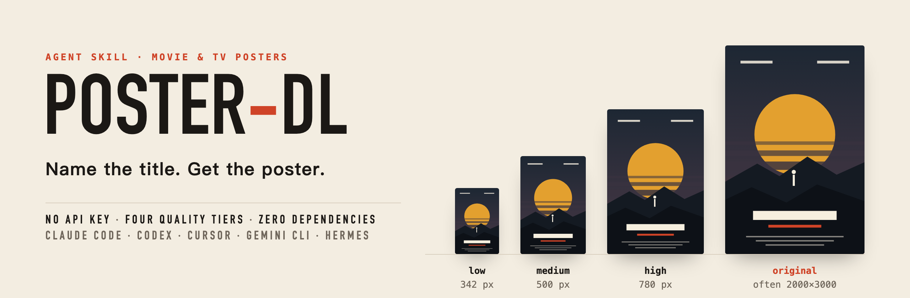

<p align="center">
  <picture>
    <source media="(prefers-color-scheme: dark)" srcset="assets/banner-dark-en.png">
    
  </picture>
</p>

<p align="center">
  <a href="README.md">简体中文</a> &nbsp;·&nbsp; <b>English</b>
</p>

<p align="center">
  
  
  
  
  
</p>

# poster-dl

**Name the title. Get the poster.**

poster-dl is a skill for AI agents (Claude Code, Codex, Cursor, Gemini CLI, Hermes and others). Say "download the poster for Breaking Bad" and it saves the poster of that film, series, anime or documentary to your disk, at the quality you choose.

It works right after install, with no account to create. A free TMDB key is needed only for season posters, a specific language version, or choosing among several posters, and the skill walks you through setting it up when that comes up.

## Highlights

| | | |
|---|---|---|
| **No key needed**<br/>The default source needs no login, so the first request after install already works. | **Four quality tiers**<br/>342px, 500px, 780px or the source file. It never upscales, and tells you when the source is smaller than you asked for. | **Search in any language**<br/>Chinese, English or the original title all work, and the file is named the way you said it. |
| **No guessing between namesakes**<br/>Dune from 1984 or 2021? It lists the candidates, or you add the year. | **Works across agents**<br/>A standard `SKILL.md` plus one Python script that uses only the standard library. Any agent that can run a shell command can use it. | **More with a key**<br/>With a TMDB key: season posters, Chinese / English / textless versions, and every available poster to pick from. |

## Install

Tell your agent:

```text
Install https://github.com/imoneys10k/poster-dl as a skill.
```

Or from the command line:

```bash
npx skills add imoneys10k/poster-dl
```

Or clone it into your agent's skills folder:

```bash
git clone https://github.com/imoneys10k/poster-dl ~/.agents/skills/poster-dl
```

| Agent | Skills folder |
|---|---|
| Codex and other agents that read the shared folder | `~/.agents/skills/` |
| Claude Code | `~/.claude/skills/` |
| Gemini CLI | `~/.gemini/skills/` |
| Cursor | `~/.cursor/skills/` |
| Hermes | `~/.hermes/skills/` |

If you use several agents, clone once and symlink the rest: `ln -s ~/.agents/skills/poster-dl ~/.claude/skills/poster-dl`.

The only requirement is Python 3.8 or newer.

## What it looks like

```text
You     Download the Breaking Bad poster

Agent   Saved: ~/Downloads/posters/Breaking Bad (2008) [original].jpg
        Source file, 2000×3000, 4.1 MB. Say high / medium / low for a smaller one.
```

```text
You     The Dune poster, high quality is enough

Agent   There are several titles called "Dune". Which one?
        1. Dune (2021) · film · Timothée Chalamet, Rebecca Ferguson
        2. Dune: Part Two (2024) · film · Timothée Chalamet, Zendaya
        3. Dune: Part Three (2026) · film · Timothée Chalamet, Zendaya
        4. Dune: Prophecy (2024) · series · Emily Watson, Olivia Williams
        5. Dune (1984) · film · Kyle MacLachlan, Virginia Madsen

You     The 1984 one

Agent   Saved: ~/Downloads/posters/Dune (1984) [high].jpg, 780×1218.
```

```text
You     The season 2 poster for Breaking Bad, textless

Agent   Season posters and language versions need a free TMDB key, and none is set up yet:
        1. Sign up at themoviedb.org and verify your email
        2. Request a key under Settings → API (choose Developer)
        3. Send me the API key and I will save and verify it
        Without a key I can download the main series poster instead.
```

## Quality

| Tier | Width | Good for |
|---|---|---|
| `low` | 342px | Thumbnails, lists |
| `medium` | 500px | Chat messages, note covers |
| `high` | 780px | Everyday collecting |
| `original` | Source file, often 2000×3000 | Wallpaper, print (default) |

`original` is used when you don't say. If the tier you pick is larger than the source, you get the source file as is.

## What a TMDB key adds

| | No key | With a TMDB key |
|---|---|---|
| Download the main poster by title | ✅ | ✅ |
| Four quality tiers | ✅ | ✅ |
| Season posters | — | ✅ |
| A specific language (Chinese, English, Japanese…) or textless | — | ✅ |
| List every poster, sorted by rating, and pick one | — | ✅ |
| Localized titles in search results | — | ✅ |

The key is free: sign up at [themoviedb.org](https://www.themoviedb.org/signup), request one under [Settings → API](https://www.themoviedb.org/settings/api) (choose Developer), then hand it to your agent or run:

```bash
python3 scripts/poster_dl.py config set-key <your-key>
```

The script checks the key online and saves it only if it is valid. It is stored on your machine in `~/.config/poster-dl/config.json` (mode 600) and shared by all your agents. The `TMDB_API_KEY` environment variable works too.

## Command line, without an agent

```bash
python3 scripts/poster_dl.py download "Inception"                     # source file
python3 scripts/poster_dl.py download "Dune" --year 1984 -q high      # pick by year, 780px
python3 scripts/poster_dl.py search "breaking bad" --type tv          # candidates only
python3 scripts/poster_dl.py download --id tt0903747 --name "BB"      # by id, custom file name

# These need a TMDB key
python3 scripts/poster_dl.py download "Breaking Bad" --season 2
python3 scripts/poster_dl.py download "Inception" --lang none         # textless
python3 scripts/poster_dl.py list "Inception"                         # every version
python3 scripts/poster_dl.py download --id tmdb:movie:27205 --pick 3
```

Posters go to `~/Downloads/posters/` by default. Use `--out` for a one-off folder or `config set-dir` to change it for good. Existing files are never overwritten; a number is appended instead.

All output is JSON, for agents and scripts to read. Messages are in Chinese; the `status` field and exit code are the stable interface:

| `status` | Exit code | Meaning |
|---|---|---|
| `ok` | 0 | Saved, with file path, actual resolution and source |
| `ambiguous` | 3 | Several candidates, listed in the output |
| `not_found` | 4 | Nothing matched |
| `need_key` / `bad_key` | 5 | The feature needs a TMDB key; setup steps included |
| `error` | 1 | Anything else |

## Layout

```text
poster-dl/
├── SKILL.md              Instructions the agent reads
├── scripts/poster_dl.py  All the logic, one file, standard library only
├── references/notion.md  Optional: putting the poster into a Notion database
└── assets/               Images for this page
```

## Data sources and copyright

- Without a key, the skill uses the search-suggestion endpoint of the IMDb website. It is not an official public API and may change without notice.
- With a key, the skill uses the TMDB API. This product uses the TMDB API but is not endorsed or certified by TMDB.
- Posters are the property of their respective rights holders. This tool only saves publicly available images to your disk; please keep them for personal use.
- The posters in the banner on this page are illustrations drawn for the demo and do not depict any real title.

## License

[MIT](LICENSE)
