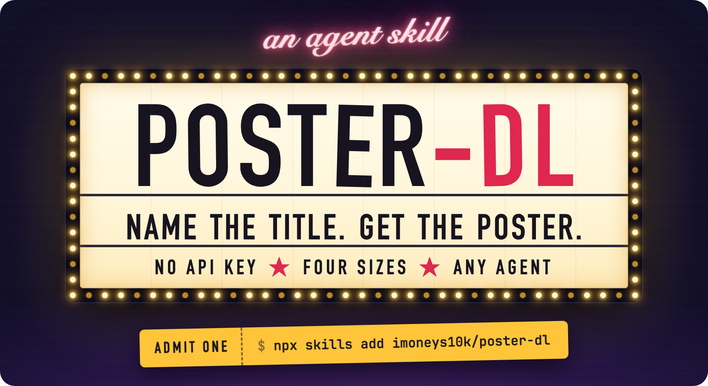
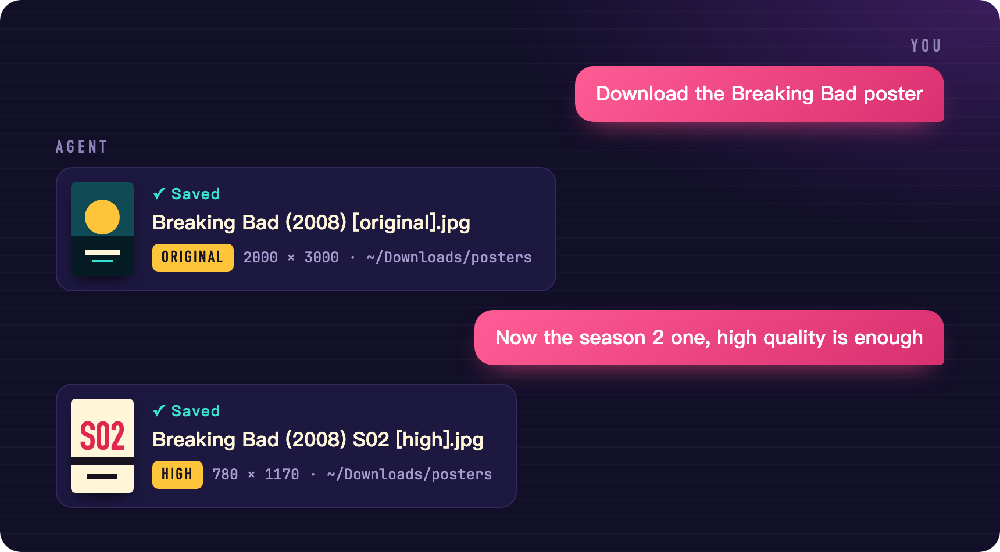
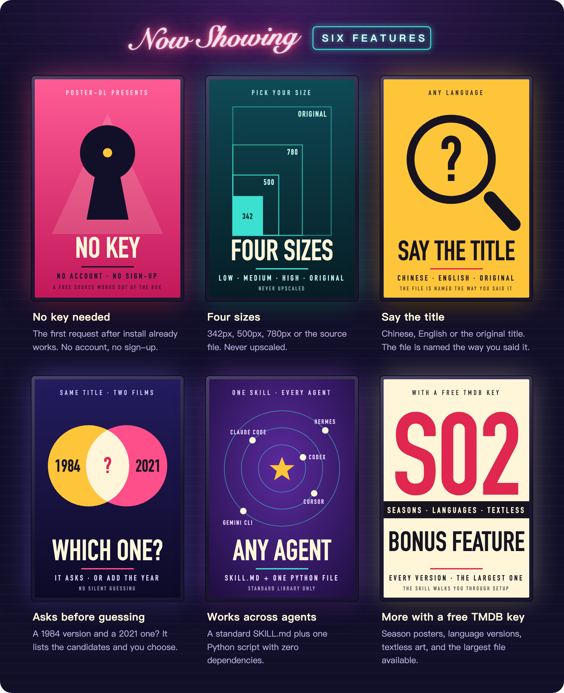

<p align="center">
  
</p>

<p align="center">
  <a href="README.md">简体中文</a> &nbsp;·&nbsp; <b>English</b>
</p>

<p align="center">
  A movie and TV poster downloader that lives inside your AI agent.<br>
  Say "download the poster for Breaking Bad" and the poster is on your disk, at the size you choose.
</p>

<p align="center">
  <a href="https://github.com/imoneys10k/poster-dl/releases"></a>
  
  
  
  <a href="LICENSE"></a>
</p>

<br>

## Admission · Install

Tell your agent:

```text
Install https://github.com/imoneys10k/poster-dl as a skill.
```

Or run one line yourself:

```bash
npx skills add imoneys10k/poster-dl
```

It works right away, with no account to create. All it needs is Python 3.8 or newer.

<details>
<summary>Manual install, and where each agent keeps its skills</summary>

<br>

```bash
git clone https://github.com/imoneys10k/poster-dl ~/.agents/skills/poster-dl
```

| Agent | Skills folder |
|---|---|
| Codex and other agents that read the shared folder | `~/.agents/skills/` |
| Claude Code | `~/.claude/skills/` |
| Gemini CLI | `~/.gemini/skills/` |
| Cursor | `~/.cursor/skills/` |
| Hermes | `~/.hermes/skills/` |

If you use several agents, clone once and symlink the rest:

```bash
ln -s ~/.agents/skills/poster-dl ~/.claude/skills/poster-dl
```

</details>

<br>

## Feature presentation · What it looks like

<p align="center">
  
</p>

When several titles share a name, it lists them and lets you choose instead of guessing:

```text
You     The Dune poster, high quality is enough

Agent   There are several titles called "Dune". Which one?
        1. Dune (2021) · film · Timothée Chalamet, Rebecca Ferguson
        2. Dune: Part Two (2024) · film · Timothée Chalamet, Zendaya
        3. Dune: Part Three (2026) · film · Timothée Chalamet, Zendaya
        4. Dune: Prophecy (2024) · series · Emily Watson, Olivia Williams
        5. Dune (1984) · film · Kyle MacLachlan, Virginia Madsen

You     The 1984 one

Agent   Saved: ~/Downloads/posters/Dune (1984) [high].jpg, 780×1218.
```

<br>

<p align="center">
  
</p>

<br>

## Sizes

| You say | Tier | Width | Good for |
|---|---|---|---|
| Thumbnail, small | `low` | 342px | Lists, headers |
| Normal, for chat | `medium` | 500px | Chat, note covers |
| High quality | `high` | 780px | Everyday collecting |
| Original, best available, or nothing | `original` | Source file, often 2000×3000 | Wallpaper, print |

If the tier you pick is larger than the source, you get the source file as is, and the result says so.

## Bonus feature · Add a TMDB key

| | No key | With a TMDB key |
|---|:---:|:---:|
| Download the main poster by title | ✅ | ✅ |
| Four sizes | ✅ | ✅ |
| Season posters | | ✅ |
| A specific language (Chinese, English, Japanese…) or textless | | ✅ |
| List every poster, sorted by rating, and pick one | | ✅ |
| Take the largest version available | | ✅ |
| Localized titles in search results | | ✅ |

The key is free. When you ask for one of these, the skill walks you through it: sign up at [themoviedb.org](https://www.themoviedb.org/signup), request a key under [Settings → API](https://www.themoviedb.org/settings/api) (choose Developer), and hand it to your agent.

The key is checked online and saved only if it is valid. It stays on your machine in `~/.config/poster-dl/config.json` (mode 600) and is shared by all your agents.

<details>
<summary>Command line, without an agent</summary>

<br>

```bash
python3 scripts/poster_dl.py download "Inception"                     # source file
python3 scripts/poster_dl.py download "Dune" --year 1984 -q high      # pick by year, 780px
python3 scripts/poster_dl.py search "breaking bad" --type tv          # candidates only
python3 scripts/poster_dl.py download --id tt0903747 --name "BB"      # by id, custom file name

# These need a TMDB key
python3 scripts/poster_dl.py config set-key <your-key>
python3 scripts/poster_dl.py download "Breaking Bad" --season 2
python3 scripts/poster_dl.py download "Inception" --lang none         # textless
python3 scripts/poster_dl.py download "Spirited Away" --largest       # largest version
python3 scripts/poster_dl.py list "Inception"                         # every version
python3 scripts/poster_dl.py download --id tmdb:movie:27205 --pick 3
```

Posters go to `~/Downloads/posters/` by default. Use `--out` for a one-off folder or `config set-dir` to change it for good. Existing files are never overwritten; a number is appended instead. The `TMDB_API_KEY` environment variable also works for the key.

</details>

<details>
<summary>Output format and exit codes</summary>

<br>

All output is JSON, for agents and scripts to read. Messages are in Chinese; the `status` field and the exit code are the stable interface.

| `status` | Exit code | Meaning |
|---|---|---|
| `ok` | 0 | Saved, with file path, actual resolution and source |
| `ambiguous` | 3 | Several candidates, listed in the output |
| `not_found` | 4 | Nothing matched |
| `need_key` / `bad_key` | 5 | The feature needs a TMDB key; setup steps included |
| `error` | 1 | Anything else |

</details>

<details>
<summary>Layout</summary>

<br>

```text
poster-dl/
├── SKILL.md              Instructions the agent reads
├── scripts/poster_dl.py  All the logic, one file, standard library only
├── references/notion.md  Optional: putting the poster into a Notion database
└── assets/               Images for this page; sources in assets/src/
```

</details>

## End credits · Data sources and copyright

- Without a key, the skill uses the search-suggestion endpoint of the IMDb website. It is not an official public API and may change without notice.
- With a key, the skill uses the TMDB API. This product uses the TMDB API but is not endorsed or certified by TMDB.
- Posters are the property of their respective rights holders. This tool only saves publicly available images to your disk; please keep them for personal use.
- The posters in the images on this page are illustrations drawn for the demo and do not depict any real title.

[MIT](LICENSE) license.
