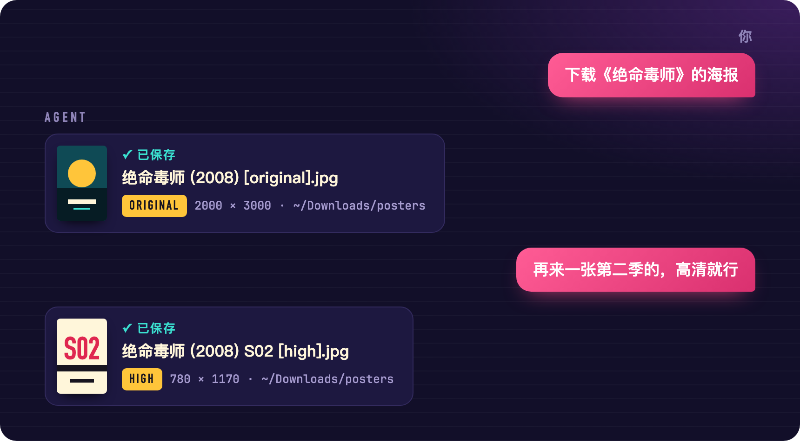

<p align="center">
  
</p>

<p align="center">
  <b>简体中文</b> &nbsp;·&nbsp; <a href="README.en.md">English</a>
</p>

<p align="center">
  装进 AI agent 的影视海报下载技能。<br>
  说一句「下载《流浪地球》的海报」，电影、剧集、动画、纪录片的海报就存到本地，画质可选。
</p>

<p align="center">
  <a href="https://github.com/imoneys10k/poster-dl/releases"></a>
  
  
  
  <a href="LICENSE"></a>
</p>

<br>

## 入场 · 安装

对你的 AI agent 说一句：

```text
请把 https://github.com/imoneys10k/poster-dl 安装成技能。
```

或者自己敲一行：

```bash
npx skills add imoneys10k/poster-dl
```

装完就能用，不需要注册任何账号。本机有 Python 3.8 或更新的版本即可。

<details>
<summary>手动安装，以及各 agent 的技能目录</summary>

<br>

```bash
git clone https://github.com/imoneys10k/poster-dl ~/.agents/skills/poster-dl
```

| Agent | 技能目录 |
|---|---|
| Codex 及其他读取通用目录的 agent | `~/.agents/skills/` |
| Claude Code | `~/.claude/skills/` |
| Gemini CLI | `~/.gemini/skills/` |
| Cursor | `~/.cursor/skills/` |
| Hermes | `~/.hermes/skills/` |

同时用好几个 agent 时，克隆一份、其余做软链接：

```bash
ln -s ~/.agents/skills/poster-dl ~/.claude/skills/poster-dl
```

</details>

<br>

## 正片 · 用起来是这样

<p align="center">
  
</p>

片名有重名时，它会先列出候选让你选，不会替你乱猜：

```text
你      沙丘的海报，高清就行

agent   「沙丘」有几个版本，要哪一个？
        1. Dune (2021) · 电影 · Timothée Chalamet, Rebecca Ferguson
        2. Dune: Part Two (2024) · 电影 · Timothée Chalamet, Zendaya
        3. Dune: Part Three (2026) · 电影 · Timothée Chalamet, Zendaya
        4. Dune: Prophecy (2024) · 剧集 · Emily Watson, Olivia Williams
        5. Dune (1984) · 电影 · Kyle MacLachlan, Virginia Madsen

你      1984 那版

agent   已保存：~/Downloads/posters/沙丘 (1984) [high].jpg，780×1218。
```

<br>

<p align="center">
  
</p>

<br>

## 画质

| 你怎么说 | 档位 | 宽度 | 适合 |
|---|---|---|---|
| 缩略图、小图 | `low` | 342px | 列表、头图 |
| 普通、发聊天用 | `medium` | 500px | 聊天、笔记封面 |
| 高清 | `high` | 780px | 一般收藏 |
| 原图、最高清，或者没说 | `original` | 源站原图，常见 2000×3000 | 壁纸、打印 |

选的档位比原图还大时，拿到的是原图，不会被放大，并且会如实告诉你。

## 加映 · 配上 TMDB key

| | 免 key | 配了 TMDB key |
|---|:---:|:---:|
| 按片名下载主海报 | ✅ | ✅ |
| 画质四档 | ✅ | ✅ |
| 分季海报 | | ✅ |
| 指定语言：中文、英文、日文……或无字版 | | ✅ |
| 列出全部海报，按评分排序后任挑一张 | | ✅ |
| 多个版本里直接取分辨率最大的一张 | | ✅ |
| 搜索结果显示中文片名 | | ✅ |

key 是免费的。用到上面这些功能时，技能会带你一步步配置：在 [themoviedb.org](https://www.themoviedb.org/signup) 注册，到 [设置 → API](https://www.themoviedb.org/settings/api) 申请（类型选 Developer），把 key 交给 agent 就行。

key 会先联网验证，通过了才保存。它只存在本机的 `~/.config/poster-dl/config.json`（权限 600），配一次，所有 agent 共用。

<details>
<summary>不经过 agent，直接用命令行</summary>

<br>

```bash
python3 scripts/poster_dl.py download "流浪地球"                     # 原图
python3 scripts/poster_dl.py download "Dune" --year 1984 -q high      # 按年份区分，780px
python3 scripts/poster_dl.py search "breaking bad" --type tv          # 只看候选
python3 scripts/poster_dl.py download --id tt0903747 --name 绝命毒师   # 按编号下载并指定文件名

# 以下需要 TMDB key
python3 scripts/poster_dl.py config set-key <你的key>
python3 scripts/poster_dl.py download "绝命毒师" --season 2
python3 scripts/poster_dl.py download "流浪地球" --lang none           # 无字版
python3 scripts/poster_dl.py download "流浪地球" --largest             # 取最大的一张
python3 scripts/poster_dl.py list "流浪地球"                           # 全部版本
python3 scripts/poster_dl.py download --id tmdb:movie:535167 --pick 3
```

海报默认存到 `~/Downloads/posters/`，用 `--out` 临时换目录，或用 `config set-dir` 长期换。同名文件不会被覆盖，会自动加序号。也可以用环境变量 `TMDB_API_KEY` 提供 key。

</details>

<details>
<summary>输出格式与退出码</summary>

<br>

所有输出都是 JSON，方便 agent 和脚本读取。

| `status` | 退出码 | 含义 |
|---|---|---|
| `ok` | 0 | 已保存，附文件路径、实际分辨率和来源 |
| `ambiguous` | 3 | 有多个候选，附候选列表 |
| `not_found` | 4 | 没搜到 |
| `need_key` / `bad_key` | 5 | 这个功能需要 TMDB key，附配置步骤 |
| `error` | 1 | 其他错误 |

</details>

<details>
<summary>目录结构</summary>

<br>

```text
poster-dl/
├── SKILL.md              给 agent 读的使用说明
├── scripts/poster_dl.py  全部逻辑，单文件，只用标准库
├── references/notion.md  可选：把海报写进 Notion 数据库的做法
└── assets/               本页用到的图，源文件在 assets/src/
```

</details>

## 片尾 · 数据来源与版权

- 免 key 时使用 IMDb 网站自身的搜索建议接口。它不是官方公开的 API，可能在没有通知的情况下变化。
- 配置 key 后使用 TMDB API。本项目使用 TMDB API，但未获得 TMDB 的认可或认证。
- 海报的版权属于各自的权利人。本工具只帮你把公开的图片存到本地，请只用于个人用途。
- 本页图片里的海报都是为演示画的示意图，不对应任何真实作品。

[MIT](LICENSE) 许可证。
