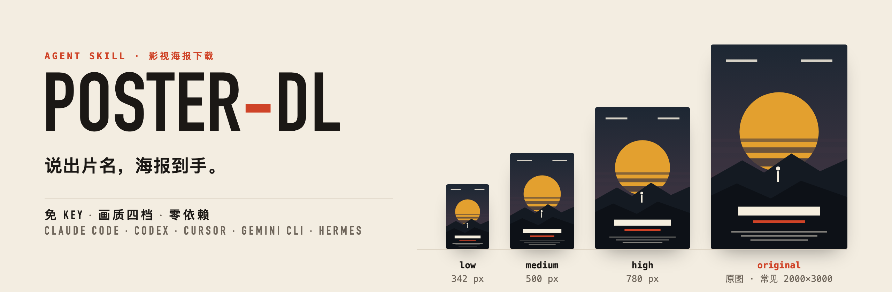

<p align="center">
  <picture>
    <source media="(prefers-color-scheme: dark)" srcset="assets/banner-dark.png">
    
  </picture>
</p>

<p align="center">
  <b>简体中文</b> &nbsp;·&nbsp; <a href="README.en.md">English</a>
</p>

<p align="center">
  
  
  
  
  
</p>

# poster-dl

**说出片名,海报到手。**

poster-dl 是装进 AI agent(Claude Code、Codex、Cursor、Gemini CLI、Hermes……)的一个技能:你说一句「下载《流浪地球》的海报」,它就把电影、电视剧、动画或纪录片的海报存到本地,画质可以选。

装完就能用,不需要注册任何账号。只有想要分季海报、指定语言版本或从多张里挑的时候,才需要一个免费的 TMDB key,到时技能会一步步带你配置。

## 亮点

| | | |
|---|---|---|
| **免 key 即用**<br/>默认走免登录的搜索接口,装完第一句话就能下载。 | **画质四档**<br/>342px、500px、780px、原图。原图不够大时不放大,如实告诉你。 | **中文片名直接搜**<br/>中文、英文、原名都行,文件按你说的片名命名。 |
| **同名不乱猜**<br/>《沙丘》有 1984 和 2021 两版?列出候选让你选,或直接带上年份。 | **到处通用**<br/>标准 `SKILL.md` 加一个 Python 脚本,只用标准库,能跑 shell 的 agent 都能用。 | **进阶可解锁**<br/>配上 TMDB key:分季海报、中文 / 英文 / 无字版、全部候选任挑。 |

## 安装

对你的 AI agent 说一句:

```text
请把 https://github.com/imoneys10k/poster-dl 安装成技能。
```

或者用命令行:

```bash
npx skills add imoneys10k/poster-dl
```

也可以手动克隆到 agent 的技能目录:

```bash
git clone https://github.com/imoneys10k/poster-dl ~/.agents/skills/poster-dl
```

| Agent | 技能目录 |
|---|---|
| Codex 及其他读取通用目录的 agent | `~/.agents/skills/` |
| Claude Code | `~/.claude/skills/` |
| Gemini CLI | `~/.gemini/skills/` |
| Cursor | `~/.cursor/skills/` |
| Hermes | `~/.hermes/skills/` |

同时用好几个 agent 时,克隆一份、其余做软链接即可:`ln -s ~/.agents/skills/poster-dl ~/.claude/skills/poster-dl`。

唯一的要求是本机有 Python 3.8 或更新的版本。

## 用起来是这样

```text
你      下载绝命毒师的海报

agent   已保存:~/Downloads/posters/绝命毒师 (2008) [original].jpg
        原图 2000×3000,4.1 MB。需要小一点的可以换 high / medium / low。
```

```text
你      沙丘的海报,高清就行

agent   「沙丘」有几个版本,要哪一个?
        1. Dune (2021) · 电影 · Timothée Chalamet, Rebecca Ferguson
        2. Dune: Part Two (2024) · 电影 · Timothée Chalamet, Zendaya
        3. Dune: Part Three (2026) · 电影 · Timothée Chalamet, Zendaya
        4. Dune: Prophecy (2024) · 剧集 · Emily Watson, Olivia Williams
        5. Dune (1984) · 电影 · Kyle MacLachlan, Virginia Madsen

你      1984 那版

agent   已保存:~/Downloads/posters/沙丘 (1984) [high].jpg,780×1218。
```

```text
你      绝命毒师第二季的海报,要中文版

agent   分季海报和语言版本需要一个免费的 TMDB key,目前还没配置。步骤是:
        1. 打开 themoviedb.org 注册并验证邮箱
        2. 在 设置 → API 里申请,类型选 Developer
        3. 把 API Key 发给我,我来保存和验证
        不配置的话,我可以先下载全剧的主海报。
```

## 画质

| 档位 | 宽度 | 适合 |
|---|---|---|
| `low` | 342px | 缩略图、列表 |
| `medium` | 500px | 聊天里发、笔记封面 |
| `high` | 780px | 一般收藏 |
| `original` | 源站原图,常见 2000×3000 | 壁纸、打印(默认) |

不说画质时用 `original`。选的档位比原图还大时,拿到的是原图,不会被放大。

## TMDB key 能多做什么

| | 免 key | 配了 TMDB key |
|---|---|---|
| 按片名下载主海报 | ✅ | ✅ |
| 画质四档 | ✅ | ✅ |
| 分季海报 | — | ✅ |
| 指定语言:中文、英文、日文……或无字版 | — | ✅ |
| 列出全部海报,按评分排序后任挑一张 | — | ✅ |
| 搜索结果显示中文片名 | — | ✅ |

key 是免费的:在 [themoviedb.org](https://www.themoviedb.org/signup) 注册,到 [设置 → API](https://www.themoviedb.org/settings/api) 申请(类型选 Developer),然后把 key 交给 agent,或者自己运行:

```bash
python3 scripts/poster_dl.py config set-key <你的key>
```

脚本会先联网验证,通过了才保存。key 只存在本机的 `~/.config/poster-dl/config.json`(权限 600),配一次,所有 agent 共用。也可以用环境变量 `TMDB_API_KEY`。

## 不经过 agent,直接用命令行

```bash
python3 scripts/poster_dl.py download "流浪地球"                     # 原图
python3 scripts/poster_dl.py download "Dune" --year 1984 -q high      # 按年份区分,780px
python3 scripts/poster_dl.py search "breaking bad" --type tv          # 只看候选
python3 scripts/poster_dl.py download --id tt0903747 --name 绝命毒师   # 按编号下载并指定文件名

# 以下需要 TMDB key
python3 scripts/poster_dl.py download "绝命毒师" --season 2
python3 scripts/poster_dl.py download "流浪地球" --lang none           # 无字版
python3 scripts/poster_dl.py list "流浪地球"                           # 全部版本
python3 scripts/poster_dl.py download --id tmdb:movie:535167 --pick 3
```

海报默认存到 `~/Downloads/posters/`,用 `--out` 临时换目录,或用 `config set-dir` 长期换。同名文件不会被覆盖,会自动加序号。

所有输出都是 JSON,方便 agent 和脚本读取:

| `status` | 退出码 | 含义 |
|---|---|---|
| `ok` | 0 | 已保存,附文件路径、实际分辨率和来源 |
| `ambiguous` | 3 | 有多个候选,附候选列表 |
| `not_found` | 4 | 没搜到 |
| `need_key` / `bad_key` | 5 | 这个功能需要 TMDB key,附配置步骤 |
| `error` | 1 | 其他错误 |

## 目录结构

```text
poster-dl/
├── SKILL.md              给 agent 读的使用说明
├── scripts/poster_dl.py  全部逻辑,单文件,只用标准库
├── references/notion.md  可选:把海报写进 Notion 数据库的做法
└── assets/               本页用到的图
```

## 数据来源与版权

- 免 key 时使用 IMDb 网站自身的搜索建议接口。它不是官方公开的 API,可能在没有通知的情况下变化。
- 配置 key 后使用 TMDB API。本项目使用 TMDB API,但未获得 TMDB 的认可或认证。
- 海报的版权属于各自的权利人。本工具只帮你把公开的图片存到本地,请只用于个人用途。
- 本页横幅里的海报是为演示画的示意图,不对应任何真实作品。

## 许可证

[MIT](LICENSE)
